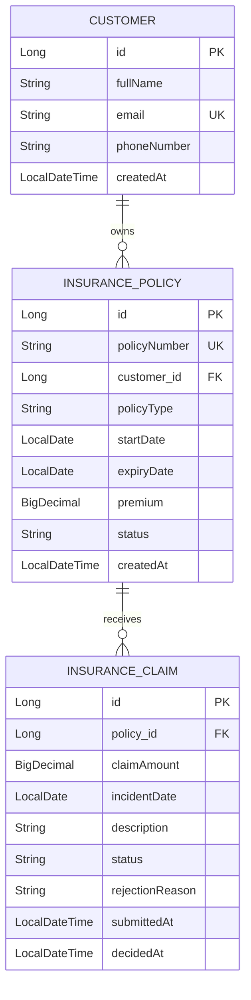
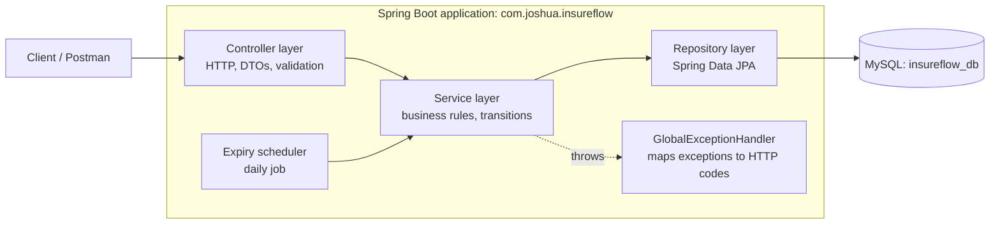

# InsureFlow – Business Rules, Design and API Plan

Illustrative rules for a learning/portfolio project. Not real insurance advice.

## 0. Conventions

HTTP codes used everywhere:

| Code | Meaning | Used when |
|---|---|---|
| 201 | Created | A record was created |
| 200 | OK | Read or action succeeded |
| 400 | Bad request | Input is malformed or fails field validation |
| 404 | Not found | A referenced record doesn't exist |
| 409 | Conflict | Duplicate of something that must be unique |
| 422 | Unprocessable | Input is valid, but a business rule forbids the operation |

Error response shape (all errors):

```json
{ "timestamp": "2026-10-24T10:15:00", "status": 422, "error": "Unprocessable Entity",
  "message": "Policy is not ACTIVE", "path": "/api/policies/5/claims" }
```

A failed operation saves nothing.

---

## 1. Customer rules

| ID | Rule | Outcome |
|---|---|---|
| C-1 | `fullName` and `email` are required | 400 |
| C-2 | `email` must have a valid format | 400 |
| C-3 | `email` must be unique, compared case-insensitively | 409 |
| C-4 | Requesting a customer ID that doesn't exist | 404 |

---

## 2. Policy rules

Statuses: PENDING, ACTIVE, EXPIRED, CANCELLED.

| ID | Rule | Outcome |
|---|---|---|
| P-1 | Policy number is generated by the system as `<TYPE>-<YEAR>-<SEQ>` (MOT, HLT, PRP), e.g. `MOT-2026-001`. Clients cannot supply it. It is unique (database constraint). | n/a |
| P-2 | A policy must be created for an existing customer | 404 |
| P-3 | `expiryDate` must be after `startDate` | 400 |
| P-4 | `premium` must be greater than zero | 400 |
| P-5 | A new policy always starts as PENDING | n/a |
| P-6 | Status changes must follow the transition table below | 422 |
| P-7 | Only ACTIVE policies can receive claims | 422 |
| P-8 | A scheduled job runs daily at 00:05 and sets every ACTIVE policy whose `expiryDate` is before today to EXPIRED. It touches no other status. | n/a |
| P-9 | Because the job can be late or down, claim eligibility also checks dates (see CL-4). Status alone is never trusted. | 422 |

### Policy transition table

| From | Allowed to | Not allowed to | Reason |
|---|---|---|---|
| PENDING | ACTIVE, CANCELLED | EXPIRED | A policy that never started can't expire. It is activated or abandoned. |
| ACTIVE | EXPIRED, CANCELLED | PENDING | Coverage can't go back to "not started". It ends by time or by decision. |
| EXPIRED | none | PENDING, ACTIVE, CANCELLED | The contract ended naturally. Renewal is a new policy. |
| CANCELLED | none | PENDING, ACTIVE, EXPIRED | Deliberate termination. Reversing it would rewrite history. |

**Terminal states:** EXPIRED and CANCELLED.

---

## 3. Claim rules

Statuses: SUBMITTED, UNDER_REVIEW, APPROVED, REJECTED.

| ID | Rule | Outcome |
|---|---|---|
| CL-1 | A claim must reference an existing policy | 404 |
| CL-2 | `claimAmount` must be greater than zero | 400 |
| CL-3 | `description` is required | 400 |
| CL-4 | `incidentDate` must fall between the policy's `startDate` and `expiryDate` (inclusive) and must not be in the future | 422 |
| CL-5 | The policy must be ACTIVE (see P-7) | 422 |
| CL-6 | A new claim always starts as SUBMITTED | n/a |
| CL-7 | Status changes must follow the claim transition table | 422 |
| CL-8 | Rejecting a claim requires a non-blank reason | 400 |
| CL-9 | APPROVED means a decision was recorded. It does not mean money was paid. No payment logic exists in v1. | n/a |
| CL-10 | Claim status is changed only through action endpoints, never by a client-supplied `status` field | n/a |

Not in v1 (future enhancements): coverage limits, approved amount, deductibles, documents, payments, appeals, authentication and roles (Spring Security phase).

### Claim transition table

| From | Allowed to | Not allowed to | Reason |
|---|---|---|---|
| SUBMITTED | UNDER_REVIEW | APPROVED, REJECTED | A claim can't skip review. |
| UNDER_REVIEW | APPROVED, REJECTED | SUBMITTED | Review ends in a decision. It doesn't go backwards. |
| APPROVED | none | SUBMITTED, UNDER_REVIEW, REJECTED | A recorded decision is final. Reconsideration needs its own rules. |
| REJECTED | none | SUBMITTED, UNDER_REVIEW, APPROVED | Same as above. |

**Terminal states:** APPROVED and REJECTED.

---

## 4. Entities and relationships

### Customer

| Field | Java type | Required | Unique | Notes |
|---|---|---|---|---|
| id | Long | yes | yes | PK, auto-generated |
| fullName | String | yes | no | |
| email | String | yes | yes | valid format |
| phoneNumber | String | no | no | String: leading zeros, `+234` |
| createdAt | LocalDateTime | yes | no | set by the system |

### InsurancePolicy

| Field | Java type | Required | Unique | Notes |
|---|---|---|---|---|
| id | Long | yes | yes | PK |
| policyNumber | String | yes | yes | system-generated |
| customer | Customer | yes | no | FK `customer_id` |
| policyType | enum | yes | no | MOTOR, HEALTH, PROPERTY |
| startDate | LocalDate | yes | no | |
| expiryDate | LocalDate | yes | no | after startDate |
| premium | BigDecimal | yes | no | greater than 0 |
| status | enum | yes | no | PENDING, ACTIVE, EXPIRED, CANCELLED |
| createdAt | LocalDateTime | yes | no | |

### InsuranceClaim

| Field | Java type | Required | Unique | Notes |
|---|---|---|---|---|
| id | Long | yes | yes | PK |
| policy | InsurancePolicy | yes | no | FK `policy_id` |
| claimAmount | BigDecimal | yes | no | greater than 0 |
| incidentDate | LocalDate | yes | no | within policy period |
| description | String | yes | no | |
| status | enum | yes | no | SUBMITTED, UNDER_REVIEW, APPROVED, REJECTED |
| rejectionReason | String | only if REJECTED | no | |
| submittedAt | LocalDateTime | yes | no | |
| decidedAt | LocalDateTime | only if decided | no | set on approve/reject |

### ER diagram



---

## 5. Architecture



| Layer | Responsibility | Must not |
|---|---|---|
| Controller | Receive requests, validate input shape, call the service, return responses | Contain business rules |
| Service | Enforce every business rule and status transition | Know about HTTP details |
| Repository | Read and write the database | Contain business rules |
| Exception handler | Turn exceptions into the standard error response | |

Entities are never returned directly. Controllers use request/response DTOs.

---

## 6. API endpoint plan

Base path: `/api`

### Customers

| Method | Path | Purpose | Success | Failures |
|---|---|---|---|---|
| POST | /customers | Register a customer | 201 | 400, 409 |
| GET | /customers/{id} | Get one customer | 200 | 404 |
| GET | /customers | List customers | 200 | |

### Policies

| Method | Path | Purpose | Success | Failures |
|---|---|---|---|---|
| POST | /policies | Create a policy (starts PENDING) | 201 | 400, 404 |
| GET | /policies/{id} | Get one policy | 200 | 404 |
| GET | /customers/{id}/policies | List a customer's policies | 200 | 404 |
| POST | /policies/{id}/activate | PENDING to ACTIVE | 200 | 404, 422 |
| POST | /policies/{id}/cancel | PENDING or ACTIVE to CANCELLED | 200 | 404, 422 |

### Claims

| Method | Path | Purpose | Success | Failures |
|---|---|---|---|---|
| POST | /policies/{policyId}/claims | Submit a claim (starts SUBMITTED) | 201 | 400, 404, 422 |
| GET | /claims/{id} | Get one claim | 200 | 404 |
| GET | /policies/{id}/claims | List a policy's claims | 200 | 404 |
| POST | /claims/{id}/review | SUBMITTED to UNDER_REVIEW | 200 | 404, 422 |
| POST | /claims/{id}/approve | UNDER_REVIEW to APPROVED | 200 | 404, 422 |
| POST | /claims/{id}/reject | UNDER_REVIEW to REJECTED, body: `{ "reason": "..." }` | 200 | 400, 404, 422 |

Status changes are separate action endpoints (CL-10), so a caller can never just send `"status": "APPROVED"`.

---

## 7. Acceptance criteria

Each line becomes a test (Postman first, automated tests later).

**Customers**
- [ ] Valid customer returns 201 with an `id`.
- [ ] Missing `fullName` or `email` returns 400.
- [ ] `adaexample.com` returns 400.
- [ ] Same email twice, including different letter case, returns 409.
- [ ] Unknown customer ID returns 404.

**Policies**
- [ ] Valid policy returns 201, status PENDING, and a generated policy number like `MOT-2026-001`.
- [ ] Unknown `customerId` returns 404 and nothing is saved.
- [ ] `expiryDate` on or before `startDate` returns 400.
- [ ] Premium 0 or negative returns 400.
- [ ] PENDING to ACTIVE succeeds. ACTIVE to PENDING is impossible (no endpoint, and the service rejects it).
- [ ] Activating an EXPIRED or CANCELLED policy returns 422.
- [ ] Cancelling a CANCELLED policy returns 422.
- [ ] The expiry job sets only ACTIVE policies past their expiry date to EXPIRED.

**Claims**
- [ ] Valid claim on an ACTIVE policy returns 201, status SUBMITTED.
- [ ] Policy ID 99999 returns 404 and nothing is saved.
- [ ] Policy in PENDING, EXPIRED or CANCELLED returns 422.
- [ ] Claim amount 0 or negative returns 400.
- [ ] Incident date before start, after expiry, or in the future returns 422.
- [ ] Policy still ACTIVE but already past `expiryDate` returns 422 (job-down case).
- [ ] SUBMITTED to APPROVED directly returns 422.
- [ ] Reject without a reason returns 400. Reject with a reason stores it.
- [ ] Changing an APPROVED or REJECTED claim returns 422.

---

## 8. Phase 2 done when

- [ ] This file is committed to `docs/business-rules.md`.
- [ ] ER diagram and architecture diagram render on GitHub.
- [ ] Every rule has an ID, an outcome and a matching acceptance criterion.
